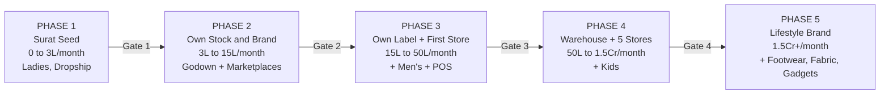
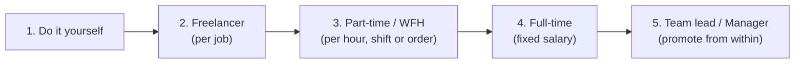

# 🚀 Scaling Roadmap: Phase 1 → Phase 5
### Zero-Capital Surat Start → Warehouse + 5 Stores + Multi-Category Lifestyle Brand
> **ERP:** Odoo 18 **Community Edition** (free) + OCA modules (free), no paid licences at any phase  
> **Starting point:** No money, based in Surat, selling ladies' wear online direct to customers  
> **End goal:** Central warehouse, 5 retail stores, Ladies + Men + Kids, and new verticals (fabric, footwear, accessories/gadgets)

> [!IMPORTANT]
> **The golden rule of this roadmap:** **Profit and data move you to the next phase. Ambition and time do not.**  
> You only move up when you clear the **Phase Gate** (Section 3) for **3 months in a row** and can pay for the next phase from **retained profit**, not loans, ad money or vendor credit.

---

## 📋 Table of Contents
1. [The Big Picture](#1-the-big-picture)
2. [Lessons from Brands That Scaled This Way](#2-lessons-from-brands-that-scaled-this-way)
3. [Phase Gates: When to Move to the Next Phase](#3-phase-gates-when-to-move-to-the-next-phase)
4. [Day-1 Foundations & Naming Standards (Brand, Domains, Instagram, Stores, Odoo)](#4-day-1-foundations--naming-standards)
5. [Phase 1: Surat Seed (Online, Zero Stock, Ladies Only)](#5-phase-1--surat-seed)
6. [Phase 2: Own Stock & Brand (Micro-Godown + Marketplaces)](#6-phase-2--own-stock--brand)
7. [Phase 3: Own Label + Men's + First Store](#7-phase-3--own-label--mens--first-store)
8. [Phase 4: Central Warehouse + 5 Stores + Kids](#8-phase-4--central-warehouse--5-stores--kids)
9. [Phase 5: Lifestyle Brand + New Verticals](#9-phase-5--lifestyle-brand--new-verticals)
10. [New Verticals Playbook (Fabric, Chappals, Gadgets)](#10-new-verticals-playbook)
11. [Odoo Module Master Matrix (All Phases)](#11-odoo-module-master-matrix)
12. [Server & Infrastructure Scaling](#12-server--infrastructure-scaling)
13. [Red Flags: When to STOP or Roll Back](#13-red-flags-when-to-stop-or-roll-back)
14. [Team & Hiring Master Plan (Part-time → WFH → Full-time)](#14-team--hiring-master-plan)

---

## 1. The Big Picture



| | **Phase 1** | **Phase 2** | **Phase 3** | **Phase 4** | **Phase 5** |
| :--- | :--- | :--- | :--- | :--- | :--- |
| **Name** | Surat Seed | Own Stock & Brand | Own Label + First Store | Warehouse + 5 Stores | Lifestyle Brand |
| **Monthly revenue** | ₹0 – ₹3 L | ₹3 L – ₹15 L | ₹15 L – ₹50 L | ₹50 L – ₹1.5 Cr | ₹1.5 Cr + |
| **Annual revenue** | up to ~₹36 L | up to ~₹1.8 Cr | up to ~₹6 Cr | up to ~₹18 Cr | ₹18 Cr + |
| **Orders / day (online)** | 0 – 12 | 12 – 50 | 50 – 150 | 150 – 400 | 400 + |
| **Full-time staff** | 0 (just you) | 1 – 2 | 6 – 10 | 25 – 45 | 50 + |
| **Part-time / WFH** | 1 – 2 (packing helper + WFH support) | 3 – 5 | 4 – 7 | 8 – 15 | 15 – 25 |
| **Freelancers** | Photographer, CA | Photographer, Reels editor, CA | Shoot team, CA firm (audit) | Agency / retainers | Agencies |
| **People cost cap** | ≤ 8% of revenue | ≤ 10% | ≤ 12% | ≤ 14% | ≤ 15% |
| **Space** | Home | 300–800 sq ft godown (Surat) | 1,500 sq ft WH + 1 store | 5,000+ sq ft central WH + 5 stores | WH + 5 own stores + franchise |
| **Categories** | Ladies only | Ladies (deeper) + dupattas/unstitched | Ladies + **Men** | Ladies + Men + **Kids** | + **Footwear, Fabric, Accessories/Gadgets** |
| **Channels** | Own website + Instagram + WhatsApp | + Myntra / Ajio / Amazon / Flipkart / Meesho | + 1 physical store (POS) | + 5 stores, omnichannel | + Franchise, B2B, multi-website |
| **Stock model** | Dropship from Surat vendors | Hybrid: bestsellers in stock, long tail dropship | Own-label job-work production | Central WH replenishes stores | Multi-category WH zones |
| **Odoo cost** | ₹0 licences | ₹0 | ₹0 | ₹0 | ₹0 |

---

## 2. Lessons from Brands That Scaled This Way

These figures come from public reports and news coverage. Treat them as indicative, not audited.

| Brand | How they started | When they went offline | Lesson for you |
| :--- | :--- | :--- | :--- |
| **Libas** (women's ethnic, founded 2014) | Bootstrapped for about 10 years. Grew mainly through **marketplaces (Myntra, Amazon, Flipkart)** instead of opening stores early. Moved to a fast-fashion design-to-shelf model. | Pushed into company-owned stores only after reaching hundreds of crores in revenue. First institutional round (~₹150 Cr from ICICI Venture) came in 2024. | Closest match to your model. **Ladies' ethnic wear + marketplaces + bootstrapping works.** Use marketplaces in Phase 2 for volume. |
| **Snitch** (menswear, D2C launch July 2020) | Founder ran a B2B garment business first (supplying shops), then pivoted to D2C in lockdown with **4 people, a makeshift warehouse and 35 styles**. Dropped new styles quickly. | **First store in July 2023** (Bengaluru), 3 years after the D2C launch. Picked store locations **from online order data**. Scaled stores using a **franchise model**. | Use **online data to choose store cities**. Use **franchising** in Phase 5 to grow stores without your own capital. |
| **The Souled Store** (founded 2013) | Online-first pop-culture apparel. | Scaled stores only after building strong brand recall. Reported revenue of ~₹360 Cr in FY24. | Stores work best **after** people already know your brand online. |
| **Bewakoof** (founded 2012) | Digital-first for close to 10 years. | Opened stores later, once revenue was ~₹150 Cr+. | Online brands usually open big mall stores at ₹150–250 Cr revenue. |

### Why this roadmap opens a store earlier (Phase 3) than these brands
Big brands wait until ₹150 Cr+ because **mall stores** cost crores in rent, deposits and fit-out. Your Phase 3 store is different:
* It is a **small high-street store (300–600 sq ft) in Surat**, your home market, where rent is low.
* It doubles as your **photo studio, returns/exchange counter and customer experience space**.
* It only opens if Gate 2 is met in full, including a cash reserve.

> [!TIP]
> If Surat rents are too high when you reach Phase 3, **skip the store**, stay online and on marketplaces (the Libas path), and open stores in Phase 4. The Odoo setup still works because POS is only an add-on.

---

## 3. Phase Gates: When to Move to the Next Phase

### How to read a gate
* ✅ **Must-have:** you must hit **all** of these.
* ➕ **Signals:** you should see **at least 2** of these.
* ⏱️ **Duration:** sustained for **3 consecutive months** (one festive month does not count).
* 💰 **Cash rule:** the next phase's set-up cost **plus 6 months of its fixed costs** must already be in the bank, from profit.

### Key definitions (track these in Odoo dashboards from Day 1)
| Metric | Formula | Where in Odoo |
| :--- | :--- | :--- |
| **Net Revenue** | Sales − Returns − RTO − Discounts (excl. GST) | Invoicing → Reporting |
| **Contribution Margin (CM)** | (Net Revenue − Product cost − Shipping − Payment fees − Ad spend − Packaging) ÷ Net Revenue | Sales/Invoicing reports + ad spend entered as vendor bills |
| **RTO %** | Orders returned to origin ÷ Orders shipped | Inventory → Deliveries (returns) |
| **Repeat Customer %** | Customers with 2+ orders ÷ Total customers | Sales → Customers → group by order count |
| **ROAS** | Revenue from ads ÷ Ad spend | Meta Ads / Google Ads (UTM tags in Odoo) |
| **Inventory Turns** (Phase 2+) | Annual COGS ÷ Average inventory value | Inventory → Reporting → Valuation |
| **Runway** | Cash in bank ÷ Monthly fixed costs | Invoicing → Bank journal |

---

### 🚦 Gate 1: Phase 1 → Phase 2 (Start holding your own stock)
| Type | Criteria |
| :--- | :--- |
| ✅ Revenue | **₹3 L+ net revenue / month** for 3 months (~10–12 orders/day at ~₹900 AOV) |
| ✅ Profit | **Contribution margin ≥ 20%** after ads, shipping, RTO and fees |
| ✅ Cash | **₹2–3 L saved from profit** (enough to buy bestseller stock + 6 months of godown rent) |
| ✅ Customers | **1,000+ customers** in total |
| ➕ Signal | Repeat customers ≥ 15% |
| ➕ Signal | Vendor stock-outs or late dispatch hitting > 5% of orders (dropship is now the bottleneck) |
| ➕ Signal | 10–20 SKUs make up > 50% of sales (clear bestsellers worth stocking) |
| ➕ Signal | RTO ≤ 25% |

### 🚦 Gate 2: Phase 2 → Phase 3 (Own label, Men's category, first store)
| Type | Criteria |
| :--- | :--- |
| ✅ Revenue | **₹15 L+ net revenue / month** for 3 months |
| ✅ Profit | **Net profit positive for 6 months**, CM ≥ 25% |
| ✅ Cash | **₹10–15 L reserve** (store deposit, fit-out, opening stock, and the first job-work production run) |
| ✅ Customers | **10,000+ customers**, repeat ≥ 25% |
| ➕ Signal | Inventory turns ≥ 4 per year (stock is not piling up) |
| ➕ Signal | Customers asking for men's wear (DMs, reviews), or men already buying for spouses |
| ➕ Signal | ≥ 15% of orders from Surat / South Gujarat (local demand for a store) |
| ➕ Signal | Marketplace ratings ≥ 4.0 |

### 🚦 Gate 3: Phase 3 → Phase 4 (Central warehouse, up to 5 stores, Kids)
| Type | Criteria |
| :--- | :--- |
| ✅ Revenue | **₹50 L+ net revenue / month** for 3 months |
| ✅ Store proof | **Store #1 profitable at store level for 6 months** (store sales cover rent, staff, power and stock margin) |
| ✅ Category proof | Men's ≥ 20% of revenue and profitable on its own |
| ✅ Cash | **₹40–60 L reserve** (or committed franchise partners) |
| ➕ Signal | Odoo data shows 3–4 cities with strong order clusters (where stores 2–5 should go) |
| ➕ Signal | Stock accuracy ≥ 97% in physical counts |
| ➕ Signal | You have managers for operations and finance (not just you) |

### 🚦 Gate 4: Phase 4 → Phase 5 (New verticals, franchise, lifestyle brand)
| Type | Criteria |
| :--- | :--- |
| ✅ Revenue | **₹1.5 Cr+ net revenue / month** for 3 months |
| ✅ Profit | **Net profit ≥ 8–10%** |
| ✅ Stores | All 5 stores profitable (or weak ones closed or relocated) |
| ✅ Customers | **1 lakh+ customers**, repeat ≥ 30% |
| ➕ Signal | Kids ≥ 10% of revenue |
| ➕ Signal | Inventory turns ≥ 5 |
| ➕ Signal | Franchise enquiries arriving without you asking |

---

## 4. Day-1 Foundations & Naming Standards

Getting these right in Phase 1 costs nothing. Fixing them in Phase 4 costs months.

### 4.1 Product category tree (build the full tree now, even if you only use Ladies)
```
All
├── Apparel
│   ├── Ladies          ← Phase 1
│   │   ├── Kurtis & Kurti Sets
│   │   ├── Sarees
│   │   ├── Dress Materials (Unstitched)
│   │   ├── Co-ord Sets
│   │   └── Dupattas
│   ├── Men             ← Phase 3
│   │   ├── Shirts
│   │   ├── Kurtas
│   │   └── T-Shirts
│   └── Kids            ← Phase 4
│       ├── Girls
│       └── Boys
├── Fabrics (Sold per Metre)   ← Phase 2/5
├── Footwear                   ← Phase 5
└── Accessories & Gadgets      ← Phase 5
```
Set this up in **Inventory → Configuration → Product Categories**. Each category can carry its own **income/expense accounts** and **costing method**, which gives you category-wise P&L later.

### 4.2 SKU naming convention (Internal Reference)
```
[CATEGORY]-[TYPE]-[DESIGN#]-[COLOR]-[SIZE]
LAD-KUR-0001-MAR-M     → Ladies Kurti, design 0001, Maroon, Medium
MEN-SHT-0042-NVY-L     → Men Shirt, design 0042, Navy, Large
FTW-CHP-0007-BRN-07    → Footwear Chappal, design 0007, Brown, UK 7
FAB-RAY-0103-PNK-MTR   → Fabric Rayon, design 0103, Pink, per metre
```

### 4.3 Other Day-1 rules
* **Register for GST** (selling pan-India is inter-state supply, and marketplaces require a GSTIN) and **Udyam (MSME)**. Confirm with a CA.
* **Separate business bank account** from Day 1, linked to Odoo as its own bank journal.
* **Record every expense in Odoo** (ads, courier, packaging) as vendor bills. Without this, your phase-gate numbers are guesses.
* **Production must run on a cloud VPS, not your laptop.** The local Docker setup in this repo is for learning and testing. See Section 12.
* **Never modify Odoo core code.** Put every customisation in `addons/` as a custom module so upgrades stay possible.

> [!CAUTION]
> This repository contains `.env` and a `credentials` file. If the GitHub repo is public, **change every password** (master password, DB password, admin password) before you put anything into production.

### 4.4 Choosing the brand name (one name for all 5 phases)
`YourBrand` / `yourbrand` below is a placeholder. Replace it with your real brand.

| ✅ Do | ❌ Avoid |
| :--- | :--- |
| Short: 1–2 words, ≤ 10 letters, easy to spell in English, Hindi and Gujarati | Long or hard-to-spell names |
| **Category-neutral**, so it still works for Men, Kids, Footwear and Accessories later | Names tied to one category or city, e.g., *"SuratKurti"*, *"LadiesHub"*, *"SareeWala"*. They block Phases 3–5 |
| Check that `yourbrand.in` **and** `yourbrand.com` are both available | Names where only odd domains are left (`.shop`, `.store`) |
| Check that the same **Instagram, Facebook and YouTube handle** is free | Different handles on each platform |
| Search **IP India trademark database** (ipindiaonline.gov.in) before you finalise | Names close to an existing fashion brand. Myntra/Ajio may reject them and you risk a legal notice |

**Trademark filing plan** (cheaper fee for individuals, startups and MSMEs. Use a trademark agent or CA):
| Class | Covers | When to file |
| :--- | :--- | :--- |
| **25** | Clothing, footwear, headwear | **Phase 1** (file in the first month. Marketplaces like Myntra/Ajio ask for it) |
| **35** | Retail and online store services | Phase 2–3 |
| **24** | Fabrics / textiles (cut cloth) | Before launching fabric |
| **14 / 18** | Jewellery / bags & accessories | Before launching those lines |
| **9** | Electronics / gadgets | Phase 5 (or file under the separate gadget brand) |

### 4.5 Domains, website and email standards
| Item | Standard | Phase |
| :--- | :--- | :--- |
| **Main domain** | `yourbrand.in` (primary site customers see, India-focused) | P1 |
| **Protection domain** | `yourbrand.com` → 301 redirect to `yourbrand.in` | P1 (buy both on Day 1) |
| **Odoo backend** | `yourbrand.in/odoo` (same server; restrict by strong passwords + 2FA) | P1 |
| **Staging / test** | `staging.yourbrand.in` (password-protected, not indexed by Google) | P2 |
| **Category pages** | `yourbrand.in/ladies`, `/men`, `/kids`, `/footwear`, `/fabrics`. **Use paths, not separate domains** (all SEO strength stays on one domain) | P1 onwards |
| **Collections** | `yourbrand.in/collections/festive-navratri-2026`, `/under-999`, `/new-arrivals` (lowercase, hyphens, no spaces) | P1 onwards |
| **Blog** | `yourbrand.in/blog` (styling tips, size guides, which helps SEO) | P1 |
| **Store locator** | `yourbrand.in/stores` and `yourbrand.in/stores/surat-adajan` | P3 |
| **Franchise / B2B portal** | `partners.yourbrand.in` or `yourbrand.in/partners` | P5 |
| **Separate gadget brand** | New brand + new domain (e.g., `gadgetbrand.in`) on the **same Odoo** (multi-website) | P5 |

**Email addresses** (use Zoho Mail or Google Workspace on your domain, never Gmail for the business):
| Address | Used for | Phase | Odoo link |
| :--- | :--- | :--- | :--- |
| `hello@yourbrand.in` | Public contact (website, Instagram bio) | P1 | Odoo alias → CRM leads |
| `orders@yourbrand.in` | Order confirmations / shipping emails sent by Odoo | P1 | Outgoing mail server |
| `support@yourbrand.in` | Customer complaints, returns | P1 | P4: alias → Helpdesk tickets |
| `accounts@yourbrand.in` | Vendor bills, GST, CA communication | P1 | Alias → Vendor Bills |
| `purchase@yourbrand.in` | POs to Surat vendors | P2 | PO emails sent from here |
| `careers@yourbrand.in` | Hiring (part-time / WFH applications) | P2 | Recruitment (`hr_recruitment`, Community) |
| `firstname@yourbrand.in` | Each full-time employee | P3+ | Also the Odoo login |
| `partners@yourbrand.in` | Franchise / B2B enquiries | P5 | Alias → CRM (B2B team) |

### 4.6 Social media & marketplace naming standards
| Platform | Main handle (same everywhere) | Fallback if taken | Phase |
| :--- | :--- | :--- | :--- |
| **Instagram** | `@yourbrand` | `@yourbrand.in` or `@yourbrandofficial` | P1 |
| **Facebook Page** | `facebook.com/yourbrand` | `/yourbrand.in` | P1 |
| **YouTube** | `@yourbrand` | `@yourbrandindia` | P1 (Shorts) |
| **Pinterest** | `yourbrand` | `yourbrandin` | P2 |
| **WhatsApp Business** | Display name: **YourBrand**. Use a **dedicated business number**, never your personal one | | P1. P2–3: move to the WhatsApp Business API (multi-agent, e.g., Interakt / Wati / AiSensy) |
| **Google Business Profile** | One per store: **"YourBrand – Adajan, Surat"** | | P3 onwards |
| **Marketplaces** (Myntra, Ajio, Amazon, Flipkart, Meesho) | Seller/brand display name = **YourBrand** (exact same spelling) | | P2 |

**Category accounts: when to split.** Keep **one Instagram** (`@yourbrand`) and use Highlights such as *Ladies / Men / Kids*. Open `@yourbrand.men` or `@yourbrand.kids` only when that category is **≥ 20% of revenue** and has its own content team (Phase 4+). Splitting early divides your followers.

**Instagram bio template:**
```
YourBrand | Ethnic & Fusion Wear 🇮🇳
✨ New drops every Friday
🚚 Free shipping above ₹999 | Easy size exchange
📍 Surat · Shipping Pan-India
👇 Shop now
yourbrand.in
```

### 4.7 Legal entity & store naming
| Item | Standard | Phase |
| :--- | :--- | :--- |
| **Legal entity** | Sole proprietorship with trade name **"YourBrand Fashion"** (GST + Udyam) | P1–P2 |
| | Convert to **"YourBrand Retail Pvt Ltd"** (or LLP), needed before the store lease, franchise and investors | P3 (ask your CA) |
| | Separate entity for gadgets, e.g., **"YourBrand Tech LLP"** or a new brand company | P5 |
| **Store signage** | **YOURBRAND** (logo only, no category words) | P3+ |
| **Store full name** | **"YourBrand – [Locality], [City]"** e.g., *YourBrand – Adajan, Surat* | P3+ |
| **Franchise store** | **"YourBrand – Navsari"** for customers (same as COCO). Internally coded `FR01` | P4–P5 |
| **Labels / hang tags** | Brand logo + `yourbrand.in` + `@yourbrand` + care instructions + MRP + size + SKU barcode | P2 |
| **Shipping label (even in dropship)** | Sender = **YourBrand**, return address = **your address** (never the vendor's) | P1 |

### 4.8 Odoo internal naming standards
Set these on Day 1. Renaming codes later breaks document prefixes and reports.

| Odoo object | Standard | Examples |
| :--- | :--- | :--- |
| **Company** | Legal name | `YourBrand Fashion` → later `YourBrand Retail Pvt Ltd` |
| **Warehouses** (short code max 5 chars) | `CWH` = central / godown (**use this from Phase 1**, even at home), `ST01`–`ST05` = own stores, `FR01`+ = franchise | `CWH – Central Warehouse, Surat`, `ST01 – Adajan, Surat` |
| **Storage locations** | `CWH/Stock/[CATEGORY]/[Rack]-[Shelf]` | `CWH/Stock/LAD/R01-S03`, `CWH/Stock/MEN/R05-S01` |
| **POS configs** | `[STORE]-POS-[n]` | `ST01-POS-1`, `ST01-POS-2` |
| **Payment journals** | Short codes | `RZP` (Razorpay), `COD` (cash on delivery), `BNK1` (main bank), `CSH01` (Store 1 cash) |
| **Analytic accounts** | `CH-` channel, `CAT-` category, `ST-` store | `CH-WEB`, `CH-MYNTRA`, `CH-ST01`, `CAT-LAD`, `CAT-MEN`, `CAT-KID` |
| **Vendors** | `[Business name] – [Market], [City]` | `Radhe Synthetics – Millennium Mkt, Surat` |
| **Job-work vendors** | `JW – [Name] – [Process]` | `JW – Shree Stitching – Kurti` |
| **Pricelists** | `[Channel/Type] [Currency]` | `Retail INR`, `Myntra INR`, `Wholesale B2B INR`, `Festive Diwali 2026` |
| **Coupon codes** | UPPERCASE, short, with year | `WELCOME10`, `DIWALI26`, `NAVRATRI26`, `STORE01OPEN` |
| **Website product names** | `[Colour] [Pattern] [Product] – [Fabric]` | `Maroon Floral Anarkali Kurti Set – Rayon` |
| **Product image files** | `[SKU-without-size]-[n].jpg` | `LAD-KUR-0001-MAR-1.jpg`, `LAD-KUR-0001-MAR-2.jpg` |
| **Invoice numbering** | Indian financial year based, **max 16 characters** (GST rule), unique per FY | `INV/2627/00001`, POS: `ST01/2627/00001` |
| **User logins** | Work email | `priya@yourbrand.in`. WFH agents: `support1@yourbrand.in` → later personal work emails |

---

## 5. Phase 1: Surat Seed (Detailed Setup & Operations)
> **Online · Zero Stock · Ladies Only · ₹0 → ₹3 L/month**

### 5.1 Zero-Warehouse Flow Architecture
In Phase 1, you sell apparel online without investing capital in warehouse rental or holding massive unsold inventory.

```
┌────────────────────────────────────────────────────────┐
│               CUSTOMER PLACES ORDER ONLINE             │
│            (Selects Product, Size, Color, Pays)        │
└───────────────────────────┬────────────────────────────┘
                            │
                            ▼
┌────────────────────────────────────────────────────────┐
│                     ODOO ERP                           │
│  - Generates Sales Order (SO)                          │
│  - Generates Tax Invoice (GST 5% / 18%)                │
│  - Automatically triggers Drop-ship Purchase Order(PO) │
└───────────────────────────┬────────────────────────────┘
                            │
                            ▼
┌────────────────────────────────────────────────────────┐
│             SURAT TEXTILE VENDOR / TRADER              │
│  - Receives PO & Shipping Label                        │
│  - Picks fabric / garment, packs with your branding    │
└───────────────────────────┬────────────────────────────┘
                            │
                            ▼
┌────────────────────────────────────────────────────────┐
│                  COURIER DISPATCH                      │
│      (Shiprocket / Delhivery pickup directly in Surat) │
│                ==> Delivered to Customer               │
└────────────────────────────────────────────────────────┘
```

### 5.2 Business Economics & Sourcing
| Item | Plan |
| :--- | :--- |
| **Capital needed** | ~₹25,000 – ₹50,000 (domain, VPS, samples, first photoshoot, first ₹10–15k of ads) |
| **Sourcing** | 5–10 wholesalers in Surat textile markets (Ring Road, Millennium, Raghukul, etc.). Buy **only after the customer pays** (dropship / buy-on-order). |
| **Product range** | 30–60 designs, 1–2 sub-categories (e.g., kurti sets + sarees), price band ₹699–₹1,999 (stays in the 5% GST slab) |
| **Channels** | Own Odoo website + Instagram + WhatsApp Business. Meesho optional for volume. |
| **Fulfilment** | Vendor packs, courier aggregator (Shiprocket/Delhivery) picks up from the vendor or from you |
| **COD** | Allow, but add prepaid incentives (e.g., ₹50 off on UPI) to keep RTO under control |

### 5.3 Technical Prerequisites & System Start
1. Install **Docker Desktop for Windows** with WSL2 enabled.
2. From the root directory (`d:\codes\django erp`), start the system:
   ```powershell
   .\start.bat
   ```
3. Verify containers are active:
   ```powershell
   docker ps
   ```
4. Access the Odoo interface:
   - **URL:** [http://localhost:8069](http://localhost:8069)
   - **Database Master Password:** `masteradmin` (configured in `.env`)

### 5.4 Database & Indian GST Configuration
When creating your initial database at `http://localhost:8069`:
* **Database Name:** `fashion_store` (or your brand name)
* **Email:** `admin@yourbrand.in`
* **Country:** **India** *(Required for automatic Indian GST, CGST/SGST/IGST tax rules, and Indian Chart of Accounts)*
* **Language:** English
* **Demo Data:** **Unchecked** (Leave blank for clean production data)

**Company Profile Setup:**
Navigate to: **Settings → Users & Companies → Companies → Select your company**:
* **Company Name:** Your Brand Private Limited / Sole Proprietorship
* **Address:** Registered office address
* **State:** Your operating state (used to calculate Inter-state IGST vs Intra-state CGST/SGST)
* **Currency:** `INR (₹)`
* **GSTIN:** Enter your 15-digit Indian GST number

### 5.5 Core Apps to Install in Phase 1
Navigate to the **Apps** menu and install the following modules:

| App Name | Technical Name | Source | Purpose in Phase 1 |
| :--- | :--- | :--- | :--- |
| **Website & eCommerce** | `website_sale` | Community | Online clothing storefront, product catalog, cart, and checkout |
| **Sales** | `sale_management` | Community | Customer sales orders, pricing rules, quotes |
| **Invoicing** | `account` | Community | Indian GST-compliant invoices, customer receipts, vendor bills |
| **Indian localisation (GST)** | `l10n_in` | Community | Auto-loaded with India country: CGST, SGST, IGST tax structures |
| **Purchase** | `purchase` | Community | Vendor management and automatic Purchase Orders for Surat suppliers |
| **Inventory** | `stock` | Community | Base inventory and stock route engine |
| **Drop Shipping** | `stock_dropshipping` | Community | Direct-to-customer delivery routing from vendor location |
| **Razorpay payments** | `payment_razorpay` | Community | UPI, Netbanking, Cards |
| **Cash on Delivery** | `payment_custom` | Community | Wire/COD-style provider with optional fee |
| **CRM** | `crm` | Community | Track WhatsApp/Instagram inquiries and high-intent leads |
| **Live Chat** | `im_livechat` | Community | Live chat on website for WFH customer support |
| **Email Marketing** | `mass_mailing` | Community | Customer newsletters and abandoned cart campaigns |
| **Website Blog** | `website_blog` | Community | SEO styling articles, size guides |

### 5.6 Master Data Configuration

#### A. Product Attributes & Size Matrix
Navigate to: **Sales → Configuration → Attributes**:
1. **Size** (Select Type: *Radio* or *Select Box*):
   * Values: `XS`, `S`, `M`, `L`, `XL`, `XXL`, `Free Size`
2. **Color** (Select Type: *Color Button*):
   * Values: `Black (#000000)`, `Maroon (#800000)`, `Navy Blue (#000080)`, `Mustard Yellow (#FFDB58)`, `Off-White (#FAF9F6)`
3. **Fabric Type** (Optional filter):
   * Values: `Pure Cotton`, `Rayon 14kg`, `Georgette`, `Chanderi Silk`, `Linen`

#### B. Indian HSN Codes & GST Rates
Navigate to: **Accounting → Configuration → Settings / Taxes**:
> GST rates changed on **22 Sep 2025**: the old ₹1,000 split with 5%/12% slabs no longer applies.
* **Readymade Garments ≤ ₹2,500 per piece:** 5% GST (CGST 2.5% + SGST 2.5%, or IGST 5% for inter-state)
* **Readymade Garments > ₹2,500 per piece:** 18% GST (CGST 9% + SGST 9%, or IGST 18%)
* The slab is decided **per piece**, using the price after discount, not the total bill or the MRP.
* Ask your CA to confirm rates before you go live.
* **Common HSN Codes for Apparel:**
  * `6204`: Women’s Kurtis, Suits, Dresses, Skirts
  * `6203`: Men’s Shirts, Trousers, Kurta Sets
  * `5407`: Woven fabrics / Dupattas

#### C. Surat Vendor Profiles
Navigate to: **Purchase → Orders → Vendors → New**:
* **Vendor Name:** e.g., *Radhe Synthetics – Millennium Textile Market, Surat*
* **Address:** Ring Road / Sahara Darwaja, Surat, Gujarat
* **GSTIN:** 24XXXXX... (Gujarat State Code = 24)
* **Payment Terms:** Immediate Payment / Advance / 15 Days Net
* **Contact Person & WhatsApp:** For automated PO dispatch

### 5.7 Zero-Warehouse Dropshipping Setup

1. **Enable Dropshipping Route:**
   * Go to **Inventory → Configuration → Settings**.
   * Under the **Warehouse** section, tick **Dropshipping**.
   * Click **Save**.

2. **Configure a Product for Dropship:**
   * Go to **Sales → Products → Products → New**.
   * **Product Name:** e.g., *Floral Printed Anarkali Kurti Set – Rayon*
   * **Product Type:** Goods *(Odoo 18 removed "Storable Product". Leave **Track Inventory** unticked in Phase 1 because you hold no stock; tick it in Phase 2 once you keep your own stock)*
   * **Sales Price:** ₹1,299
   * **Customer Tax:** 5% GST (HSN: `6204`). Pieces priced up to ₹2,500 are taxed at 5%.
   * Under **Attributes & Variants** tab:
     * Add `Size` (`M`, `L`, `XL`) and `Color` (`Maroon`, `Navy`).
   * Under **Purchase** tab:
     * Add Vendor: *Radhe Synthetics – Millennium Mkt, Surat*
     * Vendor Cost: ₹420
     * Delivery Lead Time: 2 days
   * Under **Inventory** tab:
     * Under **Routes**, uncheck *Buy / Deliver to Customer* and check **Dropship**.

### 5.8 Online Storefront & Checkout Setup

#### Website Branding & Trust Pages
* Go to **Website → Edit**.
* Drag and drop the **Hero Banner** block with fashion model photography.
* Add **Featured Collections** (e.g., *Festive Collection*, *Daily Casuals*, *Trending Kurtis*).
* Include essential trust pages in the footer:
  * *Size Guide*
  * *Shipping & Delivery Policy (3–7 Days Delivery Pan India)*
  * *Return & Exchange Policy (e.g., 7-day easy exchange for size issues)*
  * *Contact & WhatsApp Support*

#### Payment Gateways
* Go to **Website → Configuration → Payment Providers**:
  * **Razorpay / Cashfree:** Standard for India (supports UPI, Google Pay, PhonePe, Netbanking, Credit/Debit cards).
  * Enter your **Key ID** and **Key Secret**.
  * **Cash on Delivery (COD):** Enable COD provider with an optional condition (e.g., ₹50 extra convenience fee).

#### Courier Integration
* Integrate with **Shiprocket** or **Delhivery** via API.
* Configure pickup address as the **Surat Vendor's Address** so courier drivers collect parcels directly from the market.

### 5.9 Daily Operational Workflow
```
1. Customer buys Kurti (Size: L, Color: Maroon) on website -> Pays ₹1,299 via UPI.
2. Odoo creates:
   - Sales Order (SO001)
   - Customer Tax Invoice (INV/2627/00001)
   - Automated Purchase Order (PO001) to Surat Vendor for ₹420.
3. You review and confirm PO001 in Odoo.
4. Export Shipping Label & Packing Slip from Odoo/Shiprocket.
5. Send Packing Slip & Order details to Surat Vendor via WhatsApp.
6. Surat Vendor packs product, affixes your brand shipping label.
7. Courier (Delhivery/BlueDart) picks up from Surat and marks "In Transit".
8. Customer receives automatic SMS/Email tracking updates.
```

### 5.10 Online Marketing & Tracking Integration
Navigate to: **Website → Configuration → Settings**:
* **Meta Pixel (Facebook & Instagram):**
  * Paste your **Pixel ID** under Website settings.
  * Tracks: `PageView`, `ViewContent`, `AddToCart`, `InitiateCheckout`, and `Purchase`.
* **Google Analytics 4:**
  * Add your `G-XXXXXXXXXX` Measurement ID.
* **Social Commerce:**
  * Export the Odoo Product XML / CSV feed.
  * Connect to **Meta Commerce Manager** to tag products directly in Instagram Reels and Posts.

### 5.11 Go-Live Verification Checklist
- [ ] Docker containers running cleanly via `start.bat`.
- [ ] Database country set to **India** with default currency **INR (₹)**.
- [ ] Company GSTIN and address verified.
- [ ] Core apps installed: eCommerce, Sales, Invoicing, Purchase, Dropshipping, Razorpay, Live Chat.
- [ ] Size and Color variant attributes configured.
- [ ] At least 5 sample products created with Dropship route selected.
- [ ] Surat vendor added with purchase prices mapped.
- [ ] Razorpay / UPI test payment successfully completed.
- [ ] Dropship flow verified: Test order creates automated Purchase Order.
- [ ] Shipping policy and Return policy published on website.

### 👥 Team & Hiring: Phase 1 (start tiny)
**Target: 0 full-time · 1–2 part-time · 2 freelancers · people cost ≤ 8% of revenue**

| Role | Type | When to add | Work & hours | Indicative pay (Surat, 2026) |
| :--- | :--- | :--- | :--- | :--- |
| **You (founder)** | Full-time | Day 1 | Sourcing, Odoo, ads, content, vendors | Take a small fixed draw only once CM is positive |
| **Packing / QC helper** | Part-time (family member, neighbour, student) | When you collect goods from vendors to check quality and repack in your own packaging, **~5+ orders/day** | 2–3 hrs/day, evening, at your home | **Per order: ₹8–15** or ₹3,000–5,000/month |
| **WFH customer support (woman)** | Part-time, **work from home** | When DMs/WhatsApp > 40–50 per day or you can't reply within 1 hr | 3–4 hrs/day, **evening shift 6–10 pm** (peak shopping time) | ₹4,000–7,000/month + ₹5 per confirmed COD order |
| **Photographer / model** | Freelancer | Every new collection (2–4 per month) | Per shoot | ₹2,000–6,000 per shoot |
| **CA / tax consultant** | Freelancer | Day 1 (GST registration + monthly returns) | Monthly | ₹1,500–3,000/month |

**Why a woman for support in a ladies' wear brand:** customers ask about fit, fabric feel, blouse sizes and body-type styling. They're more comfortable asking a woman, and she can try the outfits and answer from experience. Homemakers and students in Surat who speak **Gujarati + Hindi + basic English** are ideal, and WFH works around family schedules.

**WFH setup (cost ₹0 in Odoo Community, since users are free):**
* Give her an Odoo user with **Sales / CRM: "User: Own Documents Only"**. No Invoicing, no Purchase, no data export.
* Install **Live Chat** (`im_livechat`, Community) on the website. She answers chats from home via Odoo Discuss.
* Phase 1 WhatsApp: shared **WhatsApp Business** on a dedicated phone or WhatsApp Web with linked devices.
* Daily checklist: confirm COD orders by call/WhatsApp (this cuts RTO), reply to DMs, update order status, collect reviews.

### 🏷️ Naming checklist: Phase 1
- [ ] Brand name finalised (Section 4.4) and **trademark Class 25 filed**
- [ ] `yourbrand.in` + `yourbrand.com` bought; `.com` redirects to `.in`
- [ ] `@yourbrand` on Instagram, Facebook, YouTube; WhatsApp Business display name set
- [ ] Emails: `hello@`, `orders@`, `support@`, `accounts@`
- [ ] Trade name **"YourBrand Fashion"** on GST registration
- [ ] Odoo company = legal name; warehouse code **`CWH`**; journals `RZP`, `COD`, `BNK1`
- [ ] Shipping labels show **YourBrand** + **your** return address

---

## 6. Phase 2: Own Stock & Brand
> **Micro-godown · Hybrid stock · Marketplaces · ₹3 L → ₹15 L/month**

### Business setup
| Item | Plan |
| :--- | :--- |
| **Space** | Rent a 300–800 sq ft godown or room near the Surat textile markets |
| **Stock model** | **Hybrid:** bestselling 20% of SKUs held in stock (fast dispatch, better margin from bulk buying); long tail stays dropship |
| **Branding** | Own **brand labels, hang tags, poly bags and boxes**, attached to vendor goods |
| **Channels** | Add **Myntra, Ajio, Amazon, Flipkart** (Libas grew this way) and keep Meesho for budget lines |
| **Team** | See *Team & Hiring: Phase 2* below |
| **Category depth** | Deeper Ladies range. Add **dupattas and unstitched dress materials**, which come from the same Surat vendors at low risk |

### Odoo setup: Phase 2 (add to Phase 1)
| Module | Technical name | Source | Why |
| :--- | :--- | :--- | :--- |
| Track inventory | (enable **Track Inventory** on stocked products) | Community | Real stock for bestsellers |
| Storage Locations | Inventory settings → *Storage Locations* | Community | Rack/bin locations in godown (e.g., `CWH/Stock/LAD/R01-S02`) |
| Reordering Rules | Inventory → *Replenishment* | Community | Auto-PO when a bestseller drops below minimum |
| Landed Costs | `stock_landed_costs` | Community | Add transport/packaging to product cost (true margin) |
| Barcodes on products | Inventory settings → *Barcode Scanner* (USB/keyboard scanner) | Community | Scan when packing to avoid wrong item / wrong size |
| Barcode scanning UI | `stock_barcodes` | **OCA** (`stock-logistics-barcode`) | Mobile/USB scanning screens (replaces Enterprise Barcode app) |
| Returns (RMA) | `rma` | **OCA** (`rma`) | Exchanges, size swaps, RTO restocking |
| Loyalty / Coupons / Gift cards | `loyalty`, `website_sale_loyalty` | Community | First-order coupons, referral codes |
| Pricelists | Sales settings → *Pricelists* | Community | Sale prices, festive offers, marketplace price lists |
| Financial reports | `account_financial_report` | **OCA** (`account-financial-reporting`) | P&L, Balance Sheet, Trial Balance, GL |
| Bank reconciliation | `account_reconcile_oca` | **OCA** (`account-reconcile`) | Match Razorpay/COD settlements with bank |
| Courier connector | Shiprocket / Delhivery Odoo module | **Third-party** (Odoo App Store, one-time fee) | Auto AWB, tracking, label printing |
| Marketplace connector | Amazon / Flipkart / Myntra connector | **Third-party** (or upload CSVs manually at first) | Sync orders and stock across channels |

> [!NOTE]
> Odoo's own Amazon connector is Enterprise-only. In Community, either use a paid third-party connector or **export/import order CSVs daily**, which is fine below ~50 orders/day.

**Key configuration:**
* Warehouse: 1 warehouse, **1-step delivery** (pick + ship together)
* Products in stock: Routes **Buy**, plus reordering rules. Dropship products keep the **Dropship** route
* Costing method per category: **Average Cost (AVCO)** with **automated inventory valuation**

### 👥 Team & Hiring: Phase 2 (first full-time hires)
**Target: 1–2 full-time · 3–5 part-time / WFH · freelancers · people cost ≤ 10% of revenue**

| Role | Type | When to add | Work & hours | Indicative pay (Surat, 2026) |
| :--- | :--- | :--- | :--- | :--- |
| **Godown & packing executive** | **Full-time (1st FT hire)** | **~25 orders/day** or when the part-time packer does 6+ hrs/day for 2 months | Receive stock, rack, pick, pack, hand over to courier | ₹10,000–14,000/month |
| **Packing helpers** | Part-time | Peak seasons: **Navratri, Diwali, wedding season, end-of-season sale** | 4 hrs/day, or per order | Per order ₹8–12 or ₹150–250 per shift |
| **Catalog & marketplace executive** | **Full-time (2nd FT hire)** | When you list on 3+ marketplaces | Product listings, images, prices, stock sync across Myntra/Ajio/Amazon/Flipkart | ₹12,000–18,000/month |
| **WFH customer support women** | 2–3 part-time, WFH, **in shifts** | 1 agent per ~20–25 orders/day | Shifts: **10 am–2 pm**, **2–6 pm**, **6–10 pm** | ₹5,000–8,000/month each + COD-confirmation incentive |
| **Reels / video editor** | Freelancer | 3+ Reels a week | Per video | ₹300–800 per Reel |
| **Photographer + model** | Freelancer | Weekly shoots | Per shoot | ₹3,000–8,000 per shoot |
| **CA** | Freelancer | Ongoing | GST, TDS, books review | ₹3,000–5,000/month |

**WFH support upgrade in Phase 2:**
* Move from one shared phone to the **WhatsApp Business API** (multi-agent inbox) so 2–3 women can answer from home at once.
* Each agent gets her own Odoo login (`support1@`, `support2@`) so you can see **who handled which order**.
* Weekly 30-minute video call: review complaints, size issues and RTO reasons.
* Pay a small **incentive per successful COD confirmation or exchange-instead-of-refund**. This links her pay to lower RTO and returns.

### 🏷️ Naming checklist: Phase 2
- [ ] Marketplace seller name = **YourBrand** (exact spelling) on all platforms
- [ ] Brand labels, hang tags and poly bags printed (Section 4.7)
- [ ] Trademark **Class 35** filed
- [ ] `purchase@`, `careers@` emails added; `staging.yourbrand.in` set up
- [ ] Odoo locations follow `CWH/Stock/LAD/R01-S01`
- [ ] Pricelists named `Retail INR`, `Myntra INR`, etc.; coupons `WELCOME10`, `DIWALI26`

---

## 7. Phase 3: Own Label + Men's + First Store
> **Job-work production · Men's category · Store #1 · ₹15 L → ₹50 L/month**

### Business setup
| Item | Plan |
| :--- | :--- |
| **Own label** | Stop buying finished goods for bestsellers. Buy **fabric** and send it to **Surat job-work (CMT) units** for cutting, stitching and finishing. This gives a big margin uplift and unique designs (the Snitch/Libas playbook). |
| **Men's category** | Launch with 20–40 designs (kurtas, shirts), first on the website and marketplaces |
| **Store #1** | 300–600 sq ft high-street store in Surat. Also serves as studio, exchange counter and customer-research space |
| **Warehouse** | Upgrade the godown to ~1,500 sq ft, with zones for raw fabric, WIP and finished goods |
| **Team** | See *Team & Hiring: Phase 3* below |

### Odoo setup: Phase 3 (add to Phase 2)
| Module | Technical name | Source | Why |
| :--- | :--- | :--- | :--- |
| Manufacturing | `mrp` | Community | Bill of Materials: fabric (metres) + lining + buttons + labels → finished kurti |
| Subcontracting | `mrp_subcontracting` | Community | Send fabric to job-work unit, receive finished goods, pay job-work charge |
| Point of Sale | `point_of_sale` | Community | Store billing, cash control, barcode scanning, receipts |
| POS + Loyalty | (loyalty programs work in POS) | Community | Same loyalty points online and in store |
| Employees | `hr` | Community | Staff records |
| Attendance | `hr_attendance` | Community | Store staff check-in/out (kiosk mode) |
| Time Off | `hr_holidays` | Community | Leave management |
| Expenses | `hr_expense` | Community | Staff expense claims |
| Analytic accounting | Invoicing settings → *Analytic Accounting* | Community | **Separate P&L for Online vs Store #1 vs Ladies vs Men** |
| Multi-step routes | Inventory settings → *Multi-Step Routes* | Community | Receipt → QC → Stock for production returns |
| Quality checks | `quality_control_oca` | **OCA** (`manufacture`/`quality` repos) | Check stitching/measurements on job-work receipts |
| MIS reports | `mis_builder` | **OCA** (`mis-builder`) | Monthly management dashboard (KPIs from Section 3) |

**Key configuration:**
* **2 warehouses**: `CWH` (godown) and `ST01` (Store 1). Store stock is replenished from `CWH` through **inter-warehouse resupply routes**
* POS config `ST01-POS-1` uses `ST01` stock. Online orders ship from `CWH`
* **Online-to-store returns**: customers can return online orders at the store (POS refund + RMA)
* Men's category added under the existing tree, with its own analytic account

### 👥 Team & Hiring: Phase 3 (convert best part-timers to full-time)
**Target: 6–10 full-time · 4–7 part-time / WFH · people cost ≤ 12% of revenue**

| Role | Type | When to add | Indicative pay (Surat, 2026) |
| :--- | :--- | :--- | :--- |
| **Warehouse lead** | Full-time (**promote your best packer**) | When the godown moves to ~1,500 sq ft | ₹15,000–20,000 |
| **Packers / pickers** (2–3) | Full-time (**convert your reliable part-timers**) | 1 per ~40–50 orders/day | ₹10,000–14,000 each |
| **Store sales associates** (2) | Full-time, **women preferred** (ladies' wear trials and styling) | Store #1 opening | ₹10,000–15,000 + sales incentive (1–2%) |
| **Weekend / festive store helper** | Part-time | Saturdays, Sundays, festivals | ₹300–500 per day |
| **Production / job-work coordinator** | Full-time | First own-label production run | ₹15,000–22,000 |
| **Accountant** | Full-time (in-house; the CA firm keeps audit and filings) | When you have 2 warehouses + POS + marketplaces | ₹15,000–25,000 |
| **Catalog & marketplace executive** | Full-time (from Phase 2) | | ₹14,000–20,000 |
| **Support team lead** | Full-time, **can stay WFH** (**promote your best WFH agent**) | 3+ support agents | ₹14,000–20,000 |
| **WFH support agents** (3–5) | Part-time WFH, in shifts | 1 per ~25–30 orders/day | ₹6,000–9,000 each + incentives |

**Rule for converting part-time → full-time:** convert when a part-timer has worked **6+ hrs/day for 2 consecutive months**, has **high accuracy** (wrong-item rate < 1% for packers, CSAT ≥ 4.5 for support), and the role is needed year-round, not only in festive season.

**Compliance at this size** (confirm with your CA):
* Register under the **Gujarat Shops & Establishments Act** for the store and godown.
* **ESI** applies once you reach 10 employees, **PF** at 20. Plan the cost (~13–17% on top of salary for eligible staff).
* Written offer letters, NDA (customer data), and the Odoo **HR** app for employee records and attendance.

### 🏷️ Naming checklist: Phase 3
- [ ] Converted to **YourBrand Retail Pvt Ltd** / LLP; Odoo company name updated
- [ ] Store signage **YOURBRAND**; store name **"YourBrand – Adajan, Surat"**
- [ ] Google Business Profile created with the same name; `yourbrand.in/stores/surat-adajan` page live
- [ ] Odoo: warehouse `ST01`, POS `ST01-POS-1`, journal `CSH01`, analytic `CH-ST01`, `CAT-MEN`
- [ ] Men's on `yourbrand.in/men` and as an Instagram **Highlight** (no separate account yet)
- [ ] Employee emails `firstname@yourbrand.in` = Odoo logins

---

## 8. Phase 4: Central Warehouse + 5 Stores + Kids
> **Omnichannel · Central replenishment · Kids · ₹50 L → ₹1.5 Cr/month**

### Business setup
| Item | Plan |
| :--- | :--- |
| **Central warehouse** | 5,000+ sq ft in Surat with zones: Inbound → QC → Storage (Ladies/Men/Kids) → Pick → Pack → Dispatch (online) / Store transfers |
| **Stores 2–5** | Choose cities **from Odoo order data** (top-ordering pin codes, like Snitch). Typical pattern: Surat #2, Ahmedabad, Vadodara, Mumbai suburb |
| **Store model** | Company-owned (COCO) for the first 3. Try **1 franchise** to learn the model for Phase 5 |
| **Kids** | Launch on online channels first. Move to stores once it reaches ≥ 5% of online revenue |
| **Team** | See *Team & Hiring: Phase 4* below |

### Odoo setup: Phase 4 (add to Phase 3)
| Module / Feature | Technical name | Source | Why |
| :--- | :--- | :--- | :--- |
| Multi-warehouse (1 WH + 5 stores) | `stock` (6 warehouses) | Community | Each store is its own stock location |
| 3-step delivery (Pick → Pack → Ship) | Warehouse settings | Community | High-volume online dispatch accuracy |
| Batch / Wave transfers | `stock_picking_batch` | Community | Pick 50 online orders in one walk |
| Store replenishment | Reordering rules per store + resupply routes | Community | Auto-transfer from WH to stores |
| Purchase Agreements | `purchase_requisition` | Community | Blanket orders with fabric mills and job-workers |
| Multi-POS | Multiple `point_of_sale` configs | Community | One POS per store, central reporting |
| Helpdesk | `helpdesk_mgmt` | **OCA** (`helpdesk`) | Customer tickets (online + store) |
| Budgets | `account_budget_oca` | **OCA** | Store-wise and category-wise budgets |
| Stock reporting | `stock_inventory` / cycle-count modules | **OCA** (`stock-logistics-warehouse`) | Cycle counts, stock accuracy ≥ 97% |
| Payroll | `payroll` | **OCA** (`payroll`) + Indian rules | Salaries for 15–50 staff |
| Customer portal | `portal` | Community | Order history, invoices, returns |
| Multi-company (if franchise) | Built-in | Community | Franchisee as separate company with inter-company transfers |

**Key configuration:**
* Warehouse structure:
  ```
  CWH   (Central Warehouse, Surat)   ← receives all purchases & production
  ST01  (Store 1, Surat)             ← resupplied from CWH
  ST02  (Store 2)                    ← resupplied from CWH
  ST03  (Store 3)
  ST04  (Store 4)
  ST05  (Store 5 / Franchise)        ← separate company if franchise
  ```
* Analytic plans: **Channel** (Website / Marketplace / Store) × **Category** (Ladies / Men / Kids) × **Store**
* Inter-store stock lookup: store staff can see stock in other stores (POS product info) and offer to have it shipped to the customer

### 👥 Team & Hiring: Phase 4 (managers + departments)
**Target: 25–45 full-time · 8–15 part-time / WFH · people cost ≤ 14% of revenue**

| Department | Roles (full-time unless noted) | Headcount |
| :--- | :--- | :--- |
| **Leadership** | Operations Manager (WH + stores), Finance Manager | 2 |
| **Warehouse (CWH)** | WH lead, inbound/QC, pickers, packers, dispatch | 6–10 |
| **Retail stores (5)** | 1 Store Manager + 2–3 associates per store (women preferred for ladies' sections) | 15–20 |
| **Production** | Job-work coordinators (ladies / men / kids) | 1–2 |
| **Merchandising & design** | Merchandiser/buying planner, in-house designer | 2 |
| **Marketing** | Performance marketer (Meta/Google), content & social executive | 2 |
| **Catalog & marketplaces** | Catalog executives | 2 |
| **Customer support** | Support team lead (FT) + **6–10 WFH agents** (part-time shifts; 2–3 can be full-time WFH) | 7–11 |
| **HR / Admin** | HR & admin executive (hiring, payroll, compliance) | 1 |
| **IT / Odoo** | Odoo functional admin (FT) + freelance Odoo developer on retainer | 1 + retainer |
| **Part-time** | Festive packers (via a staffing agency), weekend store staff | 5–10 seasonal |

**WFH support in Phase 4:** move tickets into Odoo **Helpdesk** (OCA `helpdesk_mgmt`). `support@yourbrand.in` becomes a ticket alias. Track response time and CSAT per agent. Offer **vernacular support** (Gujarati, Hindi, Marathi) for the cities where your stores are.

### 🏷️ Naming checklist: Phase 4
- [ ] Warehouses `CWH`, `ST01`–`ST05`, `FR01` (franchise) with full names `ST02 – [Locality], [City]`
- [ ] Each store: Google Business Profile + `/stores/[city]-[locality]` page
- [ ] Kids on `yourbrand.in/kids`; trademark classes checked for new lines
- [ ] Analytic plans: `CH-*` × `CAT-*` × `ST-*`
- [ ] `support@` → Helpdesk alias
- [ ] Consider `@yourbrand.men` / `@yourbrand.kids` only if that category is ≥ 20% of revenue

---

## 9. Phase 5: Lifestyle Brand + New Verticals
> **Multi-category · Franchise · New verticals · ₹1.5 Cr+/month**

### Business setup
| Item | Plan |
| :--- | :--- |
| **New verticals** | Add in this order: fabrics (cut cloth) → footwear (chappals) → accessories → gadgets. See Section 10 |
| **Franchise** | Grow store count with franchise partners' capital (the Snitch approach) while keeping control of stock and pricing in Odoo |
| **B2B** | Supply other boutiques/retailers with your own-label stock (Snitch's original model, in reverse) |
| **Brand structure** | Fashion stays the main brand. Gadgets go under a **separate brand or website** so fashion positioning isn't diluted |

### Odoo setup: Phase 5 (add to Phase 4)
| Module / Feature | Technical name | Source | Why |
| :--- | :--- | :--- | :--- |
| Multi-website | `website` (multiple websites) | Community | e.g., `yourbrand.in` (fashion) and `yourbrand-gadgets.in`, one backend |
| Multi-company | Built-in | Community | Separate legal entity for gadgets or franchises, with consolidated reporting |
| Units of Measure | `uom` (enable in settings) | Community | Sell fabric **per metre**, buy in **rolls/than** |
| Lots & Serial Numbers | Inventory settings → *Lots & Serial Numbers* | Community | IMEI/serial for gadgets, dye-lot for fabrics |
| Repairs | `repair` | Community | Gadget warranty repairs |
| B2B portal / wholesale | Pricelists + `portal` + `sale` | Community | Wholesale prices for B2B buyers |
| Inter-company rules | OCA `account_invoice_inter_company` / `purchase_sale_inter_company` | **OCA** (`multi-company`) | Auto-mirror franchise purchase ↔ your sale |
| Business intelligence | Metabase / Apache Superset (connect to PostgreSQL read replica) | Open source (external) | Advanced dashboards without slowing Odoo |
| Custom modules | `addons/your_brand_*` | **Your own code** | Anything specific to your business |

### 👥 Team & Hiring: Phase 5 (department heads)
**Target: 50+ full-time · 15–25 part-time / WFH · people cost ≤ 15% of revenue**

| Level | Roles |
| :--- | :--- |
| **Heads** | Head of Operations, CFO / Finance Head, Head of Marketing, Head of Retail & Franchise, HR Manager |
| **Category managers** | One per vertical: Ladies, Men, Kids, Footwear, Fabrics, Accessories (+ Gadgets under a separate team or company) |
| **Tech** | 1–2 in-house **Odoo (Python) developers**, 1 data analyst (Metabase dashboards) |
| **Franchise team** | Franchise manager + area managers (1 per 5–8 stores) |
| **B2B** | B2B sales executive (boutique/retailer supply) |
| **Customer support** | Support manager + **10–20 WFH agents** in shifts, vernacular languages, separate gadget-support queue (technical) |
| **Part-time** | Seasonal WH and store staff through an agency |

### 🏷️ Naming checklist: Phase 5
- [ ] Footwear / fabrics on `yourbrand.in/footwear`, `/fabrics` (same brand)
- [ ] Gadgets: **separate brand + domain**, separate Odoo company (`YourBrand Tech LLP` or new brand), separate website (multi-website)
- [ ] `partners.yourbrand.in` for the franchise/B2B portal; `partners@` email
- [ ] Trademark classes 24 / 14 / 18 / 9 filed before each launch
- [ ] Franchise stores named **"YourBrand – [City]"** for customers, coded `FR01`, `FR02`… in Odoo

---

## 10. New Verticals Playbook

### Rule: every new vertical re-runs Phase 1 in miniature
1. **Test with dropship first** (no stock, 20–30 SKUs, online only)
2. Hold stock only after it passes a **mini Gate 1**: ≥ 5% of total revenue, CM ≥ 20%, return rate acceptable
3. Put it in stores only after it proves itself online

### Which vertical, when, and how to set it up in Odoo

| Vertical | Earliest phase | Fit with your business | GST (verify with CA) | Odoo setup |
| :--- | :--- | :--- | :--- | :--- |
| **✂️ Cut cloth / Unstitched fabric** | **Phase 2** (test), Phase 5 (full) | ⭐⭐⭐⭐⭐ Same Surat vendors, same ladies customer | Mostly 5% (HSN 50–55 chapters, e.g., 5407, 5208) | **UoM:** sell in *Metres* (decimal qty, e.g., 2.5 m); buy in *Rolls/Than*. **Lots** for dye-lot matching. Website shows "price per metre". |
| **🩴 Footwear / Chappals** | **Phase 4** (test), Phase 5 (full) | ⭐⭐⭐⭐ Matches ethnic wear (kolhapuri, juttis), same customer | 5% if ≤ ₹2,500/pair, 18% above (HSN 64xx) | New attribute **Shoe Size (UK 3–11)**, separate POS category, size chart. Expect high size-exchange rates, so the RMA flow is important. |
| **💍 Accessories / Artificial jewellery** | Phase 4–5 | ⭐⭐⭐⭐ Libas added jewellery and perfumes. Raises AOV via add-ons | Varies (often 3%/12%/18%, check HSN) | Use as **"Optional / Accessory products"** on kurti pages for cross-sell. |
| **📱 Gadgets / Electronics** | **Phase 5 only** | ⭐⭐ Different customer, low margins, warranty/DOA risk | Mostly 18% | **Serial-number tracking** (IMEI), **Repair** module, warranty field, **separate website/brand** and ideally a **separate company** in Odoo. |

> [!WARNING]
> **Gadgets are the riskiest diversification.** Margins are thin (often 5–15% vs 50%+ on own-label apparel), returns are complex, and the customer is different. Libas expanded into *adjacent* lifestyle categories (jewellery, perfumes, kids), not electronics. If you do gadgets, run them as a separate brand and company in Odoo.

---

## 11. Odoo Module Master Matrix

> [!NOTE]
> OCA modules are ported to each new Odoo version by volunteers. Before you rely on one, check that its GitHub repo has a **`18.0` branch** containing that module. If it doesn't, wait for the port or use the nearest alternative.

| Module | Source | P1 | P2 | P3 | P4 | P5 |
| :--- | :--- | :---: | :---: | :---: | :---: | :---: |
| `website_sale` (eCommerce) | Community | ✅ | ✅ | ✅ | ✅ | ✅ |
| `sale_management` | Community | ✅ | ✅ | ✅ | ✅ | ✅ |
| `account` + `l10n_in` | Community | ✅ | ✅ | ✅ | ✅ | ✅ |
| `purchase` | Community | ✅ | ✅ | ✅ | ✅ | ✅ |
| `stock` + `stock_dropshipping` | Community | ✅ | ✅ | ✅ | ✅ | ✅ |
| `payment_razorpay` | Community | ✅ | ✅ | ✅ | ✅ | ✅ |
| `crm`, `mass_mailing`, `website_blog` | Community | ✅ | ✅ | ✅ | ✅ | ✅ |
| `im_livechat` (website chat for WFH support) | Community | ✅ | ✅ | ✅ | ✅ | ✅ |
| `hr_recruitment` (part-time / WFH hiring) | Community | | ✅ | ✅ | ✅ | ✅ |
| `loyalty`, `website_sale_loyalty` | Community | | ✅ | ✅ | ✅ | ✅ |
| `stock_landed_costs` | Community | | ✅ | ✅ | ✅ | ✅ |
| `stock_barcodes` | OCA | | ✅ | ✅ | ✅ | ✅ |
| `rma` | OCA | | ✅ | ✅ | ✅ | ✅ |
| `account_financial_report` | OCA | | ✅ | ✅ | ✅ | ✅ |
| `account_reconcile_oca` | OCA | | ✅ | ✅ | ✅ | ✅ |
| Courier + marketplace connectors | Third-party | | ✅ | ✅ | ✅ | ✅ |
| `mrp` + `mrp_subcontracting` | Community | | | ✅ | ✅ | ✅ |
| `point_of_sale` | Community | | | ✅ | ✅ | ✅ |
| `hr`, `hr_attendance`, `hr_holidays`, `hr_expense` | Community | | | ✅ | ✅ | ✅ |
| `mis_builder` | OCA | | | ✅ | ✅ | ✅ |
| `quality_control_oca` | OCA | | | ✅ | ✅ | ✅ |
| `stock_picking_batch` | Community | | | | ✅ | ✅ |
| `purchase_requisition` | Community | | | | ✅ | ✅ |
| `helpdesk_mgmt` | OCA | | | | ✅ | ✅ |
| `account_budget_oca` | OCA | | | | ✅ | ✅ |
| `payroll` | OCA | | | | ✅ | ✅ |
| Multi-company | Community | | | | (franchise) | ✅ |
| Multi-website | Community | | | | | ✅ |
| `repair` + Serial numbers | Community | | | | | ✅ |
| OCA inter-company | OCA | | | | | ✅ |

### How to add OCA modules to this Docker setup
1. Clone the OCA repo, matching the **`18.0`** branch, into `addons/`:
   ```powershell
   cd addons
   git clone -b 18.0 --depth 1 https://github.com/OCA/account-financial-reporting.git
   ```
2. Add each repo path to `addons_path` in `config/odoo.conf`:
   ```ini
   addons_path = /mnt/extra-addons/account-financial-reporting,/mnt/extra-addons/rma
   ```
3. Install any Python dependencies listed in the repo's `requirements.txt` (build a custom Docker image in Phase 3+).
4. Restart: `.\stop.bat` then `.\start.bat`
5. In Odoo: **Settings → Activate Developer Mode → Apps → Update Apps List**, then install.

> [!IMPORTANT]
> **Always test new modules on a copy of the database (staging) first.** From Phase 2 onwards, keep a staging environment for this.

---

## 12. Server & Infrastructure Scaling

| Phase | Hosting | Spec | Approx. cost/month | Backups |
| :--- | :--- | :--- | :--- | :--- |
| **P1** | 1 cloud VPS (Hetzner / DigitalOcean / Hostinger / AWS Lightsail) running this Docker setup + Nginx + free SSL (Let's Encrypt) | 2 vCPU, 4 GB RAM, 80 GB SSD | ₹600 – ₹1,500 | Daily DB dump to external storage (Google Drive / S3) |
| **P2** | Same VPS, upgraded + a small **staging** VPS | 4 vCPU, 8 GB RAM | ₹2,000 – ₹4,000 | Daily + keep 30 days |
| **P3** | Production + staging; custom Docker image with OCA modules baked in | 4–8 vCPU, 16 GB RAM | ₹4,000 – ₹8,000 | Daily + weekly offsite; test restoring every month |
| **P4** | **Separate DB server** (or managed PostgreSQL), CDN for website images, Odoo `workers` tuned | App: 8 vCPU/16 GB; DB: 4 vCPU/16 GB | ₹10,000 – ₹25,000 | Point-in-time recovery (WAL archiving) |
| **P5** | Load-balanced Odoo workers, PostgreSQL **read replica** for BI, monitoring (Uptime Kuma / Grafana) | Scale as needed | ₹25,000+ | PITR + multi-region copy |

### Odoo version upgrade policy
* Don't upgrade in the middle of a phase or during a festive season.
* Upgrade only **between phases**, using **OpenUpgrade** (OCA's free migration tool), rehearsed on staging.
* Before upgrading, check that every OCA/third-party module you use has a port for the new version.

---

## 13. Red Flags: When to STOP or Roll Back

Pause expansion and fix the basics if any of these happen for **2+ months**:

| 🚩 Red flag | What it means | What to do |
| :--- | :--- | :--- |
| CM < 10% | Ads or returns are eating your profit | Cut weak ad campaigns, raise prepaid share, fix sizing |
| RTO > 30% | COD abuse or wrong targeting | Restrict COD by pin code, add WhatsApp order confirmation |
| Inventory turns < 3 | Too much stock not selling | Clearance sale, stop buying, return stock to vendors where possible |
| Cash runway < 3 months | Danger zone | Freeze hiring and new stores, go back to dropship for new designs |
| A store loses money for 6 months | Wrong location or format | Close or relocate it. Use the same Odoo data to choose better |
| A new vertical < 3% of revenue after 6 months | No product-market fit | Stop it, sell off its stock, refocus on the core |
| People cost > phase cap (Section 1) | Hired ahead of revenue | Pause hiring; move new work to part-time / WFH until revenue catches up |

---

## 14. Team & Hiring Master Plan

### 14.1 The hiring ladder (always climb in this order)

* **Hire part-time when** a task takes **more than 2 hrs/day** of your time for 3–4 weeks.
* **Convert to full-time when** the part-timer works **6+ hrs/day for 2 months** and the work is year-round.
* **Promote from within** first: best packer → WH lead, best WFH agent → support lead, best store associate → store manager. They already know your products, Odoo and customers.
* **Variable before fixed:** pay per order or per shift until volumes are predictable. This protects cash in slow months.

### 14.2 Headcount summary by phase

| Role | P1 | P2 | P3 | P4 | P5 |
| :--- | :---: | :---: | :---: | :---: | :---: |
| Founder | 1 | 1 | 1 | 1 | 1 |
| Packing / warehouse | 1 PT | 1 FT + 1–2 PT | 3–4 FT + PT | 6–10 FT + seasonal | 15+ FT + seasonal |
| Customer support (**WFH women**) | 1 PT | 2–3 PT | 1 lead + 3–5 PT | 1 lead + 6–10 | 1 manager + 10–20 |
| Catalog / marketplace | — | 1 FT | 1 FT | 2 FT | Team |
| Store staff | — | — | 2 FT + weekend PT | 15–20 FT | Grows with stores |
| Production / job-work | — | — | 1 FT | 1–2 FT | Per category |
| Accounts / finance | CA (freelance) | CA (freelance) | 1 FT + CA | Finance Mgr + 1 | CFO + team |
| Marketing / content | Freelance | Freelance | Freelance | 2 FT | Team |
| HR / admin | — | — | — | 1 FT | HR Manager + team |
| Odoo / IT | You | You | You + freelancer | Odoo admin + retainer | 1–2 in-house devs |
| **Total full-time** | **0** | **1–2** | **6–10** | **25–45** | **50+** |
| **Total part-time / WFH** | **1–2** | **3–5** | **4–7** | **8–15** | **15–25** |

### 14.3 Women WFH customer support programme (all phases)
| Item | Standard |
| :--- | :--- |
| **Who** | Homemakers, students, women returning to work. Gujarati + Hindi (+ basic English). Interest in fashion |
| **Where to find** | Your own Instagram followers and customers (they already love the brand), local women's groups, college placement cells, Apna / WorkIndia / Naukri |
| **Shifts** | 10 am–2 pm · 2–6 pm · 6–10 pm (busiest). Flexible weekly roster |
| **Equipment** | Her own smartphone/laptop + internet. Pay a **₹300–500/month internet allowance** |
| **Odoo access** | Own login, **restricted rights** (CRM/Sales own documents, Live Chat, later Helpdesk). No exports, no invoicing, no costs/margins visible |
| **Tools by phase** | P1: WhatsApp Business → P2–3: WhatsApp Business API multi-agent + Odoo Live Chat → P4+: Odoo Helpdesk tickets |
| **Training (Week 1)** | Products and fabrics, size chart, return/exchange policy, COD confirmation script, Odoo order lookup |
| **KPIs** | First response < 15 min in shift · CSAT ≥ 4.5/5 · COD confirmation rate · exchange-instead-of-refund rate |
| **Pay structure** | Fixed monthly part-time pay + **incentives** (COD confirmations, saved returns, positive reviews) |
| **Growth path** | Agent → Senior agent → **Team lead (full-time, can stay WFH)** → Support manager |
| **Data protection** | Signed NDA + **DPDP Act 2023** awareness (customer phone numbers and addresses are personal data). Turn on Odoo 2FA for all users |

### 14.4 Part-time packing & shipping programme
| Item | Standard |
| :--- | :--- |
| **Who** | Students, local youth, family members, women from nearby (day shifts) |
| **Pay** | **Per packed order** (₹8–15) in P1–P2 → per shift (₹150–250 / 4 hrs) for peaks → full-time when year-round |
| **Quality rule** | Scan barcode while packing (Phase 2+). Wrong-item rate must stay < 1% |
| **Peak calendar** | Plan extra part-timers 3 weeks before **Navratri, Diwali, wedding season (Nov–Feb), Eid, Raksha Bandhan, end-of-season sales** |
| **Odoo** | Packers get **Inventory: User** rights only. Barcode scanning (OCA `stock_barcodes`). Attendance via `hr_attendance` kiosk from Phase 3 |

> [!NOTE]
> Salary figures are **indicative 2026 estimates for Surat** and will vary. Check current local rates on job portals before hiring, and confirm labour-law obligations (minimum wages, Shops & Establishments, ESI, PF) with your CA.

---

### ✅ Your Next Action
You are in **Phase 1**. Follow the step-by-step setup in **Section 5 (Phase 1: Surat Seed)**, finalise your **brand name, domains and handles** (Sections 4.4–4.6), build the **category tree, SKU convention and Odoo naming** (Sections 4.1, 4.2, 4.8) on Day 1, bring in your first **part-time packer and WFH support agent** only when the Phase 1 triggers are hit, and track the **Gate 1 metrics** from your first order.
